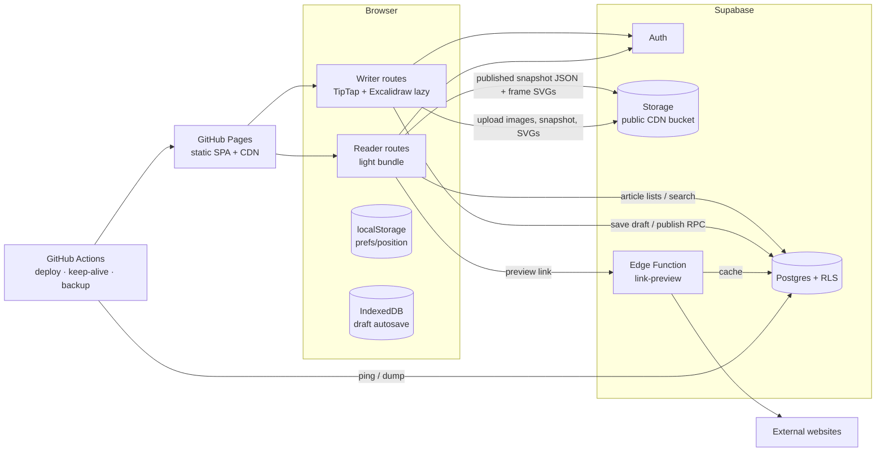
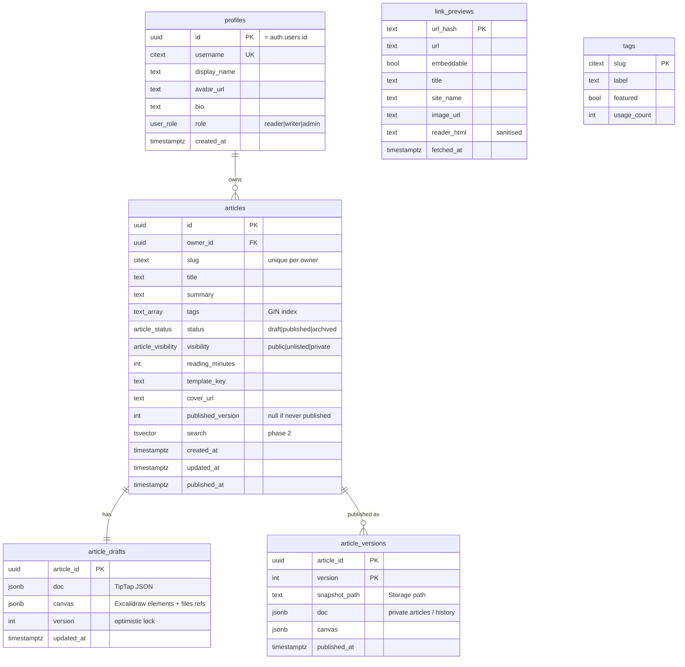

# Study Split — Product Requirements & Architecture (v0.2)

> **Status:** Approved for Phase 0 · **Date:** 2026-11-21 · **Source:** `application-idea.md`
>
> **Study Split**: study notes with the text on one side and the drawings on the other.

---

## 0. Decisions already taken

| # | Decision | Choice |
|---|---|---|
| D1 | How text and drawing relate | **One canvas per article; each text section links to a *frame* (a region) of that canvas** |
| D2 | Who can read | **Public by default**; writer can set *Unlisted* (link only) or *Private* (only me + admin) |
| D3 | ~~Brief vs Detailed~~ | **Removed 2026-11-26 (D15):** every reader sees the whole article |
| D4 | Backend | **Supabase Free** (Postgres + Auth + Storage + Edge Functions) **+ keep-alive ping** |
| D5 | Frontend hosting | **GitHub Pages** (static SPA) at `pankajsoni22.github.io/study-split-app/` |
| D6 | Sign-in | **Google only** (Google Identity Services → Supabase `signInWithIdToken`) |
| D7 | New user role | `reader` by default; admin can switch the default to `writer` |
| D8 | Private articles | Owner + admin |
| D9 | Mobile | Read-only below 768 px |
| D10 | Analytics | Per-article view counts |
| D11 | Split divider | **Fixed layouts** 70:30 · 60:40 · 50:50 · 40:60 · 30:70; the divider snaps, plus a layout picker |
| D12 | Drawing area | **Slides**: one slide fills the drawing side. Writers can zoom and pan while drawing (revised: a locked canvas was uncomfortable); switching slides re-fits; readers see fixed pictures |
| D13 | Slide shape | **Follows the article layout** (3:5 … 16:10); readers' other layouts letterbox |
| D14 | Slides per section | **Exactly one** (each H2 = one slide) |
| D15 | Product naming and scope (2026-11-26) | A section + its drawing is a **split** (Split 1, Split 2…, "Fit split", Splits panel). Tagline **"Split Makes Learning Easy"**. **No Brief/Detailed**: removed from editor, reader, templates and database (migration `20261126000000_remove_brief.sql`; flags stripped, content kept) |

---

## 1. Vision

A writing and reading platform for engineers where **every idea has a picture next to it**. Text flows on one side, a hand-drawn canvas lives on the other, and the two move together. It is equally a **publishing tool** (projects, system designs, interview experiences) and a **personal revision tool** (notes, FAQs, flashcards).

**Design principles** (used to settle every future trade-off):

1. **Reading is the product.** Readers must get a fast, calm, distraction-free page — heavy tooling is for writers only.
2. **Do the heavy work once, at publish time.** Syntax highlighting, SVG rendering of drawings, reading-time, search text — computed when the writer publishes, never on every read.
3. **Never lose a keystroke.** Local autosave always; remote save explicit (Ctrl+S) to keep backend load low.
4. **Portable by construction.** Standard Postgres, S3-style storage, Web-standard functions, all vendor code behind interfaces.

---

## 2. Users & Roles

| Role (from idea) | Internal name | Who |
|---|---|---|
| — | `anonymous` | Not signed in. Reads public/unlisted published articles. |
| USER-RO | `reader` | Signed in. Reads; can bookmark and keep reading preferences synced (phase 2). |
| USER-RW | `writer` | Everything a reader can + create, edit, publish, delete **own** articles. |
| ADMIN | `admin` | Everything; sees all articles in every state; manages users, roles, tags, templates. |

### 2.1 Permission matrix

| Action | anonymous | reader | writer | admin |
|---|:-:|:-:|:-:|:-:|
| Read published **public** / **unlisted** article | ✅ | ✅ | ✅ | ✅ |
| Read **private** article | ❌ | ❌ | own only | ✅ |
| Read **draft** | ❌ | ❌ | own only | ✅ |
| Create / edit / delete article | ❌ | ❌ | own only | ✅ (any) |
| Publish / unpublish | ❌ | ❌ | own only | ✅ (any) |
| Change user roles | ❌ | ❌ | ❌ | ✅ |
| Manage curated tags & templates | ❌ | ❌ | ❌ | ✅ |

Enforced **in the database** with Postgres Row-Level Security (RLS), not just in the UI.
A user can never change their own `role` (guarded by a DB trigger).

---

## 3. Core concepts (domain model)

```
User ──owns──▶ Article
                 ├── metadata: title, slug, summary, tags[], status, visibility, template
                 ├── Document  (rich text: ordered Sections ▶ Blocks)
                 └── Canvas    (one Excalidraw scene with named Frames)

Section ──linkedTo──▶ Frame   (0..1)
```

| Concept | Meaning |
|---|---|
| **Article** | Unit of publishing. URL: `/{username}/{slug}` (like GitHub repos). |
| **Section** | A heading + its blocks. The unit of navigation (Next/Prev, TOC, frame sync). |
| **Block** | Paragraph, heading, list, code, code-tabs, callout, TL;DR, Q&A (FAQ), image, quote, table, divider. |
| **Canvas** | One infinite whiteboard per article. |
| **Frame** | A named rectangle on the canvas (Excalidraw has a native *frame* tool). A section points to a frame; when that section is active, the canvas "camera" glides to the frame. |
| **Status** | `draft` → `published` → (`unpublished` back to draft) / `archived`. |
| **Visibility** | `public` (listed, discoverable) · `unlisted` (anyone with link) · `private` (owner + admin). |
| **Published snapshot** | An immutable copy created on publish. Editing a published article edits the *draft*; readers keep seeing the last published version until you click **Publish update**. |

> **Architect's note on D1:** "both panes scroll together" doesn't map well to a 2-D canvas (what does "scroll a whiteboard down" mean?). Frames solve it: the text scrolls naturally, and the canvas *follows* by flying to the frame of the section you are reading. Same model powers presentation mode, merge mode, mobile, and PDF.

---

## 4. Reading experience — modes

All modes render from the same article data. The mode switcher sits in the top bar; the choice is remembered per article (see §7).

| Mode | Your idea | What it does | Best for |
|---|---|---|---|
| **Flow** | Split Mode 2 | Split screen. Left text scrolls normally; right canvas glides to the frame of the section in view. Active section gets an amber margin marker; the linked frame gets a matching soft highlight. Reader can still pan/zoom the canvas freely; a "↺ follow text" chip re-syncs. | Deep reading on desktop |
| **Present** | Split Mode 1 | One section per step. `→ / Space` = next, `←` = previous, `F` = full screen. Optional sub-steps reveal blocks one by one. Progress dots at the bottom. | Explaining to others, mock interviews, self-revision |
| **Article** | Merge Mode | Classic vertical article. Each section's frame is rendered inline (as a light SVG) right after its heading. Click a figure → opens full-screen canvas at that frame. | Mobile, printing, skimming |
| **Canvas** *(new)* | — | Full-screen whiteboard. Section list becomes a floating "tour" panel; click a section → camera flies there, text shown in a side card. | Visual thinkers, big system diagrams |
| **Revise** *(new, phase 2)* | — | Collapses everything into flash-cards: each Q&A block becomes a card (question → tap → answer). Tracks "known / review again" locally. | Interview revision, FAQs |

### 4.1 Brief / Detailed toggle (removed 2026-11-26, D15)

- Removed: there is one version of every article. Existing flags were stripped by `20261126000000_remove_brief.sql`
  (nothing deleted).

### 4.1c Reading views on the experimental branch (2026-11-27)

- **Present view removed.** Two views remain: **Split** and **Article** (phones: Article).
- **Split view is one split at a time.** The text pane scrolls only within the current split. At its end a **Next
  split: N. title →** card (last split: "End of the article"), right after the text, or at the bottom of the pane when
  the split is short; no empty space below it; from split 2 on, a "‹ previous" link at the top; keys
  **[** / **]** (or Alt+← / Alt+→). The drawing follows the split.
- **Contents** (reader bar menu, and Article view's left list): all splits; the current one is marked and expands to
  show its sub-headings (H3); clicking one jumps to it.

### 4.1b Unfold (EXPERIMENTAL, branch `experimental`, 2026-11-26)

The drawing **builds up as you read**: each paragraph is a step that adds its part of the split's drawing.
- **Writer:** ⋯ menu → **Unfold** (per article, stored in the canvas JSON as `unfold: true`). While on, whatever is
  drawn while the cursor is in a paragraph belongs to that paragraph (`element.customData.unfold = blockId`). Paragraphs
  with drawings show a numbered step badge in the margin; the paragraph new drawings will join has a teal edge. Drawing
  bar **Step ▾** reassigns selected parts: "Show with paragraph N" or "Always visible".
- **Reader:** an **Unfold** switch (only on articles that use it; on by default, remembered). **Split** view: the
  paragraph at the reading line is the current step and the drawing shows everything up to it; this step's new parts
  fade in with a teal glow. **Reading marker (revised 2026-11-27):** no background (so it is never confused with a
  Highlight box); a small teal ▸ pointer sits in the margin beside the current paragraph; paragraphs **not read yet**
  fade to ~42%, the ones already read stay clear. **Which paragraph is current (stepped, revised
  2026-11-27):** a split starts at its first paragraph; each wheel notch or ↓ / ↑ moves the pointer **one paragraph**
  (a short pause between steps stops fast trackpad swipes racing ahead). The page does **not** scroll while the next
  paragraph is in view; when the pointer reaches the bottom of the visible text, the page scrolls to bring it to ~30%
  from the top. A paragraph taller than the pane scrolls normally until its end shows. At the last paragraph the
  wheel scrolls on to the Next split card; at the first, back to the top. Scroll-bar drags and jumps place the pointer
  by position; **clicking** a paragraph makes it current; empty paragraphs are skipped.
  **Enter (2026-11-27):** on a collapsible it opens / closes it (its hint reads "press Enter to expand"); the pointer
  also stops on the **‹ previous** link (up from the first paragraph) and the **Next split** card (down from the
  last), which show "Enter ↵" and a teal ring; Enter there = click. **Article** view shows finished drawings.
- **Data:** every top-level block has a stable `blockId` (added on open; kept unique by the editor). Untagged parts,
  and parts of deleted paragraphs, are always visible; a label follows its shape. No database change.
- Code: `src/domain/unfold.ts` (rules, tested), `editor/unfoldMarks.ts`, `EditorPage` (tagging), `SlideImage` (layers),
  `ReaderPage` (Split + Present). Sample: Consistent Hashing splits 1, 3, 4, 5 (`k.step(...)` in the seed kit).

### 4.1a Navigation in Article mode (2026-11-26)

- The scrolling area spans the window, so the scroll bar sits at the window edge.
- **Splits list** (wide screens): a sticky numbered list on the left; it highlights the split being read and jumps on
  click.
- **Contents** menu in the reader bar (every mode, phones too): jump to any split; in Present mode it opens that step.
- A thin reading-progress line under the bar, a **Next split** link at the end of each split, and **Back to top**.

### 4.2 Layouts and slides (revised 2026-11-22, D11–D14)

**Fixed layouts, not a free divider.** Five text : drawing layouts: `70:30 · 60:40 · 50:50 · 40:60 · 30:70`
(`src/domain/layouts.ts`).
- A **Layout** picker in the top bar (editor and reader) shows each proportion as a small icon.
- Dragging the divider **snaps** between layouts (a badge shows the current one) and commits on release;
  ←/→ step one layout; double-click returns to the article's default.
- **Two separate things** (revised 2026-11-22):
  - The **article layout** sets the slide shape and the readers' default. It's part of the article (stored with the canvas,
    so it is versioned with each published version) and is changed in **Settings → Layout & slide shape**. Templates pick
    a sensible default (System Design 40:60, Interview 60:40, others 50:50).
  - The **editor layout** is just the writer's screen: the top-bar picker and the divider.
- **Auto layout (editor, on by default):** writing (focus in the text or the title) switches to **60:40**; drawing (using
  the canvas or format bar) switches to **40:60**. Each switch is announced on the divider ("Drawing · 40 : 60").
  Picking a layout by hand turns Auto off, and the Auto button turns it back on. The canvas re-fits after a switch
  unless the writer has zoomed or panned.
- Readers may switch layout for themselves (remembered per article); slides are scaled to fit with margins.

**Slides, not an infinite canvas.** Every H2 section has exactly **one slide**: a fixed-size drawing board whose
shape follows the article layout:

| Layout | 70:30 | 60:40 | 50:50 | 40:60 | 30:70 |
|---|---|---|---|---|---|
| Slide | 3:5 (900×1500) | 3:4 (1200×1600) | 1:1 (1400×1400) | 4:3 (1600×1200) | 16:10 (1600×1000) |

- **Editor:**
  - The canvas shows the current section's slide on a "paper" sheet, fitted to the pane whenever the section changes.
    Zoom and pan work normally while drawing; **Fit slide** (or Shift+1) shows the whole slide again.
    (Revised 2026-11-22: the first version locked zoom/pan, which was uncomfortable to draw in.)
  - **Slides panel:** a slim, full-width strip of thumbnails. Clicking a slide jumps to its section; **+ Add slide**
    inserts a new section with its slide after the current one.
    - **Unpinned (default):** hidden behind a floating **Slides n / N** button at the bottom of the drawing side. Hover,
      focus or click opens it; it hides after ~3 s, 1.2 s after the pointer leaves, on a click outside, or with Esc.
    - **Pinned (📌, remembered):** docked at the bottom of the editor and always visible.
  - Slides are created, named and kept in order automatically. Each H2 shows a "Slide n" label, and the old
    "link a frame" control is gone.
  - Changing the layout reshapes all slides (with a confirmation if any slide has drawings). Drawings keep their size
    and position.
- **Reader:** slides are static pictures (SVG exported from the frame), shown whole and centred.
  - Split mode: the slide changes as you scroll the text.
  - Present mode: steps through the slides.
  - Article mode: the slides are inline.
  - Text before the first section shows the first slide.

### 4.3 Responsive behaviour

| Width | Layout |
|---|---|
| **≥ 1280px** (large) | Full split with divider. All modes. |
| **768–1279px** (medium / tablet) | Split available; default ratio 55/45; canvas pane collapsible. Landscape tablets behave like desktop. |
| **< 768px** (mobile) | No side-by-side. **Article** mode by default. **Flow** becomes "sticky figure": the current frame sits pinned in the top 40% and the text scrolls beneath it. **Present** shows canvas full-screen with text in a swipe-up bottom sheet. Swipe left/right = next/prev. |

### 4.4 Other reading features

- Sticky **table of contents** with progress (desktop left rail / mobile drawer).
- Reading time, last-updated date, author chip (`@username`), tags.
- **Code blocks:** syntax highlighting, copy button, filename label, line highlights, and **Code Tabs** (same snippet in Python / Java / C++ / Go — reader's last chosen language is remembered across articles).
- Callouts (info / tip / warning / interview-tip), tables, KaTeX math (phase 2).
- Light / dark / system theme; reading font size (S/M/L); optional serif reading font.
- Command palette `Ctrl+K`: jump to a split, switch mode, search.

---

## 5. Link preview popup (idea #14)

Internet links render in the link colour with a small **preview glyph** so readers know a click opens a preview, not a new tab.

### 5.1 Internal links (our own articles)

- Opened in a centred modal (desktop: 72% width × 85% height; mobile: full-height bottom sheet).
- Content loaded from our own published snapshot — **text only** by default.
- A slim **"Drawings ▸"** edge tab slides the canvas in over the text (and back with "◂ Text"). Section ↔ frame sync works inside the popup too.
- Header actions: **Open full article** · **Open in new tab** · **Close** (`Esc`).

### 5.2 External links — important constraint

Most sites (GitHub, Medium, Stack Overflow, news sites, Google…) **forbid being shown inside an iframe** (`X-Frame-Options` / CSP `frame-ancestors`), and the browser cannot even tell our app *why* it is blank. So a pure-iframe popup would be broken for most links.

**Solution — a `link-preview` Supabase Edge Function (free tier):**

1. Popup calls `link-preview?url=…`.
2. Function fetches the page server-side, inspects headers:
   - **Embeddable** → popup shows a live iframe.
   - **Not embeddable** → function extracts the readable article (Mozilla Readability), sanitises it, and the popup shows a beautiful **Reader View** (our typography, images, code blocks).
   - **Unreadable** (apps, login walls) → rich preview card (title, description, image, site icon) + big "Open site" button.
3. Results cached in `link_previews` for 7 days → each URL costs one fetch per week, not per click.

Safety: block private/internal IPs (SSRF), 5 s timeout, 2 MB cap, HTML sanitised with DOMPurify on render, per-IP rate limit.

Popup header for external links: favicon + domain · **Reader / Live** toggle (when both available) · **Open in new tab ↗** · **Close ✕**.

---

## 6. Writing experience

### 6.1 Editor layout

The editor uses the same split layout as the reader: **rich-text editor on the left, Excalidraw canvas on the right**, with the same adjustable divider. A toolbar toggle switches to **Preview** (any reading mode) without leaving the page.

### 6.2 Text editor

- Block-based rich text: headings, lists, checklists, quotes, tables, callouts, TL;DR, Q&A, images (paste / drag-drop), links, code, code-tabs.
- `/` slash menu for inserting blocks; Markdown shortcuts (`##`, `-`, ```` ``` ````, `>`).
- **Toolbar (compact, 2026-11-26):** **Style ▾** (text, new split, sub-heading) · bold, italic, code, link · bulleted list,
  numbered list, quote, code block · **Insert ▾** (table, highlight, collapsible, divider) · options for the block the
  cursor is in (Highlight / Collapsible colours, code language, Table controls) · full screen.
- **Heading colours (2026-11-26):** split headings (H2) in brand teal, sub-headings (H3) in brand amber, with light
  and dark values (`--heading-split`, `--heading-sub`), in the editor and every reading mode.
- Per-section menu: **Link to frame…** (pick existing frame, or *Create frame here* which adds a new frame on the canvas next to the last one).

### 6.2a Highlight boxes, collapsibles, quotes (decided 2026-11-24)

- **Highlight box:** wraps blocks in a soft background. Tones: Mint, Sand, Sky, Lilac, Peach, Paper, with separate light
  and dark values. Toolbar: ▣, then choose a tone or remove the box.
- **Collapsible:** a title plus hidden content (TipTap Details). It stays open while writing (its state is saved);
  **readers always start collapsed** and expand by clicking the title or the arrow. Use it for trade-offs or long
  explanations.
- H2 headings (splits) belong outside them.
- **Quotes** have a teal left line and a faint tint.
- The reader no longer shows the amber "current section" line (removed on request).

### 6.2c Article spacing (fixed 2026-11-26)

- Blocks in an article (paragraphs, lists, code, tables, boxes) are separated by a ~1 em gap, like a normal article;
  list items by 0.4 em. Before this fix, a stronger `p { margin: 0 }` rule cancelled the gap, so paragraphs ran
  together in the editor and the reader.

### 6.2b Tables (decided 2026-11-25)

- **Insert:** toolbar ▦ inserts a 3 × 3 table whose first row is a header. Tab / Shift+Tab move between cells.
- **While the cursor is in a table** the toolbar adds: add row below, add column right, delete row, delete column,
  header row on/off, delete table. Delete row/column act on the row/column of the cursor. Writers can drag column
  edges to resize.
- **Readers:** a header tint and zebra rows. A table wider than the screen **scrolls sideways inside its own box**
  (the page never scrolls sideways).
- Built on `@tiptap/extension-table` (TableKit), same version as the other TipTap packages. Cells hold paragraphs
  with bold, italic, code and links.

### 6.3 Canvas

- Full Excalidraw: shapes, arrows with bindings, hand-drawn style, text, images, frames, laser pointer, lock, grouping, export.
- **Format bar** (top of the drawing side; restyled 2026-11-26): outlined, labelled buttons like the writing toolbar:
  **Shapes ▾ · Stroke ▾ · Fill ▾ · Line ▾ · font ▾** (+ text size, layer and delete with a selection) · **Style** · full
  screen. On a narrow drawing side the labels hide and only icons remain. Excalidraw's own tool palette is unchanged.
- **Style panel** (2026-11-26) replaces Excalidraw's properties panel ("More options"): stroke and fill colours, fill
  pattern, width, line style, look, edges, arrow start/end heads, font/size/align for text, opacity (saved once you
  pause), and layer (front / back / delete). It styles the selection, or the next shapes when nothing is selected, and
  says which. Opens below Excalidraw's palette; ✕ or the Style button closes it.
- **Only what applies (2026-11-26):** the format bar and the Style panel show only the options the selection can use,
  or, with nothing selected, those of the active drawing tool (they then style the next shape). Select/hand tool with
  nothing selected → only **Shapes**. Examples: circles have no Edges; arrows get arrowheads but no Fill or font; text
  gets Colour, font, size and alignment; layer and delete appear only with a selection. An open Style panel hides
  while there is nothing to style and comes back on the next selection.
- **Labels in shapes** (2026-11-26): double-clicking anywhere inside a rectangle, ellipse or diamond adds (or edits) its
  centred label, which moves with the shape. Excalidraw does this only for **filled** shapes (an unfilled one is "hit"
  only on its outline), so for unfilled shapes the canvas selects the shape and triggers Excalidraw's own "edit label"
  (Enter). Double-clicking empty canvas still makes free text.
- **Built-in shape pack** (decided 2026-11-22). A **Shapes** button in the format bar opens two tabs:
  - **System design:** client, user, service, server, load balancer, API gateway, database, cache, message queue,
    object storage, CDN.
  - **Data structures:** array, stack, queue, linked list, hash map, binary tree, graph.

  A shape is inserted in the middle of the current slide as an editable group in the Study Split palette. Shapes are
  generated in code (`src/features/canvas/shapes.ts`), so there's no network access and no third-party library imports.
- Frame names auto-sync with linked section titles (editable).
- Clicking a section in the editor flies the canvas to its frame — same behaviour as reading, so writers see what readers will see.
- Pasted images are uploaded to Storage and referenced by URL (never embedded as base64 — keeps the scene small).

### 6.3a Deleting articles: Trash (decided 2026-11-22)

- **Delete article** (in Settings) asks the writer to **type the exact article title**; pasting is disabled. The article
  moves to **Trash** (`/me/trash`, also in the sidebar): readers stop seeing it at once, and My articles offers **Undo**.
- **Trash** lists deleted articles with **Restore** (back exactly as before, published or draft) and **Delete forever**
  (type the title again). After Delete forever, the writer can't see or restore it, and its address is freed.
- **Nothing is hard-deleted by the app.** The database only marks rows (`deleted_at`, `purged_at`). Users can't clear
  those marks or delete rows, even through the API (RLS + column grants). Admins restore or erase rows with the SQL in
  [`docs/03-admin-scripts.md`](03-admin-scripts.md).
- A trashed article can't be saved or published (the editor shows "This article is in the Trash · Restore").

### 6.4 Saving (idea #13)

| State | Indicator | Save button |
|---|---|---|
| Saved | "✓ Saved · 2 min ago" (muted) | Disabled |
| Unsaved changes | Amber dot + "Unsaved changes" | Enabled |
| Saving | Thin progress bar under the top bar + spinner on button | Disabled |
| Error / offline | Red "Couldn't save — retry" | Enabled |
| Conflict | "This article changed elsewhere" → *Keep mine / Load theirs / Compare* | — |

- **Ctrl/⌘ + S** saves (browser "Save page" is suppressed).
- **Local autosave** (revised 2026-11-24, no "Restore" prompt):
  - Unsaved work is written to this device (IndexedDB, one copy per article) 1.5 s after typing stops, and immediately
    when the page is hidden, closed or left.
  - Reopening shows that work directly, marked "Unsaved changes (on this device)". **Discard** returns to the saved
    version.
  - If the server copy changed elsewhere in the meantime, saving shows the usual conflict choice.
- **Leaving the editor** with unsaved changes opens a dialog: **Save & leave** · **Leave without saving** (kept on this
  device for next time) · **Stay**. Closing the tab shows the browser's own warning; the work is still kept on the device.
- **Editor top bar** (revised 2026-11-24): title with a status line under it ("Published · Saved 3:06 PM"),
  then View, Save, Publish and a ⋯ menu (Auto layout, editor layout, full screen for either side, Article settings).
- **Full screen** for the writing or the drawing side: a button at the right end of each side's toolbar (or the ⋯ menu);
  that side fills the window (browser full screen too), the other side stays loaded. Esc or the button returns.
- **Publish** shows a 10-second notification with **Read article** and a countdown bar (hover pauses it), instead of a banner.
- Optimistic concurrency: each save sends `expected_version`; the server rejects stale writes (protects against two open tabs).
- **Publish** / **Publish update** is a separate primary button with a pre-flight checklist (title, slug, summary, tags, unlinked sections warning, image alt text).

### 6.5 Templates (idea #9)

Selecting **New article** opens a template gallery. A template pre-fills sections, placeholder blocks *and* pre-placed, named canvas frames. Everything is editable after loading.

| Template | Sections (and frames) |
|---|---|
| **System Design** | Requirements (functional / non-functional) · Capacity estimates · Core entities · API design · High-level design ▣ · Deep dives ▣ · Bottlenecks & trade-offs · Interview FAQ (Q&A) |
| **Interview Experience** | Company, role, level, date, verdict (metadata card) · Process overview ▣ · Round-by-round (repeatable) · Questions asked (Q&A) · Preparation tips · What I'd do differently |
| **Software Project** | Problem & motivation · Architecture ▣ · Tech stack · Data model ▣ · Key code (code-tabs) · Challenges · Results / metrics · Lessons learned |
| **DSA / Problem Notes** | Problem · Intuition ▣ · Approach · Code (code-tabs) · Complexity · Pitfalls · Similar problems |
| **Concept Explainer** | TL;DR · Why it matters · How it works ▣ · Example · Trade-offs · Revise (Q&A) |
| **Blank** | Empty |

v1 templates ship as versioned JSON inside the frontend bundle (no DB call). Phase 2: admin-managed templates in DB + "Save my article as template".

### 6.6 Tags (idea #7)

- Up to 10 tags per article; type-ahead from existing tags; new tags allowed.
- Normalised to lowercase slugs (`System Design` → `system-design`); display label kept.
- Admin curates a "featured" set (System Design, Interview Experience, DSA, Backend, Frontend, DevOps, Projects…).
- Tag pages: `/tags/system-design`.

### 6.7 PDF export (idea #6)

- **Download PDF** uses a dedicated print stylesheet on the **Article** (merge) layout: frames rendered as crisp vector SVGs, code blocks wrapped, links printed with URLs, TOC on first page, author/date header, page numbers.
- Implementation: browser print engine (`window.print()` → *Save as PDF*). Free, vector-quality, selectable text.
- Phase 3 (on cloud): one-click server-side PDF via headless Chromium if a "real download" without the print dialog is required.

---

## 7. Remembered reading state (idea #12)

Stored in `localStorage` (small, synchronous) — **no backend calls**.

| Scope | Keys |
|---|---|
| Global | theme, reading font/size, default mode, default divider ratio, preferred code language |
| Per article (`article:{id}`) | mode, divider ratio, active section id + offset within it, canvas camera (x, y, zoom) if user panned away, present-mode step |

- Position is anchored to **section id + offset**, not raw pixels, so it survives font-size changes, screen changes and article updates.
- LRU cap of 200 articles; versioned key schema for safe future changes.
- Phase 2: signed-in readers optionally sync preferences to their profile.

---

## 8. Accounts & usernames (idea #10)

- Sign-in: **Google only** (Google Identity Services button / One Tap → ID token → `supabase.auth.signInWithIdToken`, nonce-protected). Same approach as `soni-siblings-app`.
- First sign-in → **"Claim your username"** screen, pre-filled with a suggestion (from name/email/GitHub handle, de-duplicated, e.g. `pankaj-soni`). Live availability check (debounced). User must **Accept** or **Change** before continuing.
- Rules: 3–30 chars, `a–z 0–9 -`, starts with a letter, no `--`, case-insensitive unique, reserved words blocked (`admin, api, settings, write, explore, tags, login, about, help, …`).
- Everything published lives under `/{username}/…`. Profile page `/{username}` lists their published articles.
- Username change allowed once per 30 days; old username keeps redirecting (phase 2, `username_redirects` table).
- **Default role for new sign-ups: `reader`**, configurable by admin (Admin → Settings → *Default role for new users*: reader / writer). Admin promotes individuals to `writer`. The owner's email is promoted to `admin` once via a SQL snippet (see README).

---

## 9. Additional features proposed

Prioritised; MVP items are in §13.

| Feature | Why | Phase |
|---|---|---|
| **Q&A block + Revise mode (flashcards)** | Directly serves "save FAQs from interviews" and revision | 2 |
| **Full-text search** (Postgres FTS) | Find notes across your articles; free, no extra service | 2 |
| **Revision history** (last 20 published versions, diff, restore) | Safety net for important notes | 2 |
| **Bookmarks / My library** for readers | Reason for readers to sign in | 2 |
| **Series / Collections** ("System Design 101 — Part 3") | Long-form learning paths, next/prev article | 2 |
| **PWA + offline reading** of saved articles | Revise on the metro | 2 |
| **Import Markdown / Export Markdown + .excalidraw** | No lock-in for writers | 2 |
| **Embed a single frame** in another article | Reuse diagrams | 3 |
| Comments / reactions | Community | 3 |
| Real-time co-editing | Explicitly *out of scope* for the prototype | 3+ |

---

## 10. Technology choices

### 10.1 Frontend

> **Aligned with `soni-siblings-app` (2026-11-21):** same stack and look — React + TS + Vite, React Router, plain CSS design system, a small `useQuery` hook, lucide, Inter, ESLint, Vitest, Google Identity Services, GitHub Pages via Actions. Editor-specific libraries (TipTap, Excalidraw, CodeMirror, Shiki) are added in Phase 1.

| Concern | Choice | Why |
|---|---|---|
| Framework | **React 19 + TypeScript + Vite** | Excalidraw and TipTap are React-first; Vite gives tiny, fast static builds for GitHub Pages |
| Routing | **React Router** (lazy routes) | Route-level code splitting |
| Server state | **`useQuery` hook** (from soni-siblings-app) | Per-key in-memory cache, stale-while-reload, ignores out-of-order answers → fewer DB calls, zero dependencies |
| UI state | React state/context | Enough for now; add Zustand only if the editor needs it |
| Rich text | **TipTap** (MIT, ProseMirror) | Best-in-class open-source editor; custom nodes for sections, code-tabs, Q&A, visibility flags; JSON output |
| Drawing | **Excalidraw** (MIT) | Most complete open-source hand-drawn whiteboard; native frames; `scrollToContent` camera API; libraries; dark mode. *(tldraw was rejected: its licence requires a paid licence/watermark for production use.)* |
| Code editing | **CodeMirror 6** inside TipTap code nodes | Multi-language, lightweight, great keyboard UX |
| Code highlighting | **Shiki** — run **at publish time only** | VS Code-quality highlighting; readers receive pre-highlighted tokens (zero highlighter JS for readers) |
| Styling | **Plain CSS** (`src/styles.css`) + CSS-variable tokens | Same class vocabulary as soni-siblings-app (`card`, `btn`, `field`, `segmented`, `sidebar`, `tabbar`…); ~6 KB gzipped |
| Primitives | Hand-rolled accessible components (as in soni-siblings-app) | Radix UI only if a complex widget needs it |
| Icons | **Lucide** | Open-source, tree-shakeable |
| Sanitising | **DOMPurify** | External reader-view HTML |
| Testing | **Vitest** (unit), **Playwright** (E2E) | Free, fast |

### 10.2 Backend — Supabase (D4)

| Need | Supabase feature | Portable equivalent later |
|---|---|---|
| Database | Postgres 15+ | AWS RDS/Aurora Postgres · GCP Cloud SQL / AlloyDB |
| Auth | Supabase Auth (Google ID token via Google Identity Services) | Cognito · Firebase/Identity Platform · Auth0 |
| Authorisation | Postgres RLS | Same RLS (with JWT claims) or API-layer checks |
| Files | Supabase Storage (S3-compatible) | S3 + CloudFront · GCS + Cloud CDN |
| Functions | Edge Functions (Deno, Web-standard `fetch` handlers) | Lambda · Cloud Run (thin wrapper) |
| API | Auto REST (PostgREST) + RPC functions | Same PostgREST container, or a small API service |

### 10.3 Keep-alive & backups

- **Keep-alive:** GitHub Actions cron every **3 days** calls a tiny `ping()` RPC that performs a real DB query (Supabase pauses free projects after ~7 days of inactivity).
  - ⚠️ GitHub **disables scheduled workflows after 60 days without repository activity.** Mitigation: a second free pinger (cron-job.org) hitting the same endpoint, and the workflow posts a reminder issue at day 50.
- **Backups:** Supabase Free has **no automatic backups**. A weekly GitHub Action runs `supabase db dump` and stores it **encrypted** (age/GPG) as a workflow artifact or in a *private* repo. Never in the public site repo.

---

## 11. Architecture

### 11.1 System overview



### 11.2 The key performance idea: publish-time rendering

> **Status (Phase 1):** readers load the published version with one RPC (`get_published_article`) and see slides as
> static SVG pictures, with no live canvas, so nothing to zoom or pan. The SVGs are still exported in the reader's browser,
> which needs the Excalidraw library (~0.75 MB gzipped, cached afterwards). Pre-rendering them at publish time is
> planned for 1c; with fixed-size slides this is now simple. The home page is unaffected (~150 KB gzipped).

When a writer clicks **Publish**, *the writer's browser* (which already has Excalidraw and Shiki loaded) produces:

1. `snapshot.json` — metadata + document JSON with **pre-highlighted code tokens**, computed reading time, section→frame map.
2. `canvas.svg` — the whole scene as one SVG, plus each frame's bounding box.
3. `frames/{frameId}.svg` — one small SVG per frame (for Article mode, mobile, PDF, popups).

These are uploaded to a public Storage path that is **immutable and versioned** (`published/{articleId}/v{n}/…`), so the CDN and browser can cache them forever. The DB row then points to version `n`.

**Consequences for readers:**

- Opening an article = **1 CDN JSON fetch + SVGs**; **0 database queries.**
- Readers **never download Excalidraw** (~1 MB+) or Shiki. Flow/Present modes pan/zoom the pre-rendered `canvas.svg` with CSS transforms (smooth, GPU-accelerated). An **"Open interactive canvas"** button lazy-loads Excalidraw read-only only if a reader really wants to.
- Private articles aren't put in the public bucket; they are read from the DB under RLS (owner/admin only).

### 11.3 Database-call budget

| User action | Calls |
|---|---|
| Open a published article | **0 DB** (1 CDN JSON, cached) |
| Home / explore / tag / profile list (page of 20) | **1** (metadata columns only, keyset pagination) |
| Open editor | **1** (draft row) |
| Save (Ctrl+S) | **1** RPC `save_draft` |
| Publish | **1** RPC `publish_article` + N Storage uploads |
| Username availability check | 1 per pause in typing (debounced 400 ms) |
| Reading preferences, scroll position, mode | **0** (local) |
| External link preview | 1 Edge Function call (cached 7 days server-side, session-cached client-side) |

### 11.4 Frontend module structure (migration-friendly)

```
src/
  app/                  # router, providers, layouts, error boundaries
  features/
    reader/             # Flow, Present, Article, Canvas modes; contents / splits navigation
    editor/             # TipTap setup, custom nodes, canvas pane, save/publish
    canvas/             # SVG camera (reader) + Excalidraw wrapper (writer)
    link-preview/       # popup, internal/external renderers
    articles/           # lists, cards, tags, templates gallery
    auth/               # sign-in, username onboarding
    admin/              # users, roles, all-articles table
    export/             # print stylesheet, PDF flow
  domain/               # pure TS: types, content schema,
                        # permissions, slug/username rules (100% unit-tested)
  data/
    ports/              # interfaces: ArticleRepo, AuthService, FileStore,
                        #             LinkPreviewService, SnapshotStore
    adapters/supabase/  # the ONLY folder that imports @supabase/supabase-js
  ui/                   # design-system components (Button, Dialog, Toggle…)
  lib/                  # storage (local/IndexedDB), hotkeys, analytics stub
  styles/               # tokens.css, print.css
supabase/
  migrations/           # versioned SQL — schema, RLS, functions, triggers
  functions/link-preview/
  seed.sql
.github/workflows/      # deploy.yml · keepalive.yml · backup.yml · ci.yml
```

**Migrating to AWS/GCP later** = write `data/adapters/aws/*`, point env vars at the new endpoints, run the same SQL migrations on RDS/Cloud SQL, copy the Storage bucket to S3/GCS, wrap the edge function in a Lambda/Cloud Run handler. Components and domain logic don't change.

> **Honest caveat:** RLS policies use Supabase's `auth.uid()`. On another platform you either keep PostgREST + RLS by issuing compatible JWTs, or move authorisation checks into a small API service. Both are contained changes because all access goes through `data/ports`.

### 11.5 Routing on GitHub Pages

| Route | Page |
|---|---|
| `/` | Home: featured + latest public articles |
| `/explore`, `/tags/:tag` | Discovery |
| `/:username` | Profile |
| `/:username/:slug` | Article reader |
| `/write/new`, `/write/:articleId` | Editor |
| `/me/articles` | My drafts & published |
| `/settings`, `/onboarding/username` | Account |
| `/admin` | Admin console |

GitHub Pages has no server routing, so we ship the standard `404.html` redirect trick to support clean deep links. Custom domain (free on GitHub Pages) is recommended early so URLs never change when migrating.

> **Known limitation:** a static SPA can't give each article its own social-share preview (OpenGraph image/title on LinkedIn/WhatsApp) or strong SEO. Accepted for the prototype; fixed on migration (or earlier via Cloudflare Pages / a pre-render step).

---

## 12. Data model (Postgres)



Notes:

- **Lists never touch the heavy JSON** — metadata lives in `articles`, bodies in `article_drafts` / `article_versions`.
- Tags as `text[]` + GIN index: tag filtering without join tables; `tags` table only powers suggestions/featured.
- Postgres compresses large `jsonb` automatically (TOAST). Typical article: 20–200 KB text+canvas. **500 MB free ≈ thousands of articles**; images live in Storage (1 GB), compressed to WebP client-side before upload (max 1600 px).
- `article_versions` keeps the last 20 versions per article (trimmed by trigger) — basis for revision history.
- RPCs (`SECURITY INVOKER`, RLS still applies): `save_draft(article_id, expected_version, doc, canvas, meta)`, `publish_article(article_id, snapshot_path)`, `unpublish_article`, `is_username_available`, `claim_username`, `ping`.

### 12.1 Document JSON (as built in Phase 1)

Sections are **not wrapper nodes**: every level-2 heading starts a section, and the heading carries the
section's id and its canvas link. That keeps editing natural (Enter, Backspace and paste work as usual),
and a ProseMirror plugin keeps `sectionId`s unique when a heading is split or duplicated.
Rules live in `src/domain/content.ts`; editor attributes are in `src/features/editor/extensions.ts`.

```jsonc
{
  "type": "doc",
  "content": [
    { "type": "paragraph", "content": [ /* intro: content before the first H2 */ ] },
    { "type": "heading", "attrs": { "level": 2, "sectionId": "s_k3j9x2", "frameId": "<excalidraw frame id>" },
      "content": [{ "type": "text", "text": "High-level design" }] },
    { "type": "codeBlock", "attrs": { "language": "python" },   "content": [ /* … */ ] }
  ]
}
```

The canvas is a plain Excalidraw scene, `{ "elements": [...], "files": {...} }`; frames are Excalidraw `frame` elements.
Code tabs (one snippet in several languages) are planned for 1c.

---

## 13. Requirements (MVP = Phase 1)

### 13.1 Functional

| ID | Requirement | Acceptance criteria (summary) |
|---|---|---|
| FR-01 | Sign in with Google (button + One Tap) | New user lands on username onboarding; returning user lands where they were |
| FR-02 | Claim username (accept suggestion or change) | Validation rules §8; uniqueness enforced in DB; cannot skip |
| FR-03 | Roles admin / writer / reader enforced by RLS | Direct API calls with a reader token cannot create or modify articles |
| FR-04 | Create article from template gallery | Template pre-fills sections + named frames; all editable |
| FR-05 | Split editor: TipTap left, Excalidraw right, adjustable divider | Divider 25–75%, double-click resets, persisted |
| FR-06 | Link a section to a canvas frame | Selecting section in editor flies canvas to the frame |
| FR-07 | ~~Block visibility always / detail / brief~~ | Removed 2026-11-26 (D15) |
| FR-08 | Code blocks & code tabs with highlighting and copy | ≥ 15 languages; reader's preferred language remembered |
| FR-09 | Dirty indicator, Save button, Ctrl+S, progress bar | States per §6.4; button disabled when clean or saving |
| FR-10 | Local autosave (no prompt) + leave dialog | Kill the tab mid-edit → reopening shows the work exactly where it was |
| FR-11 | Optimistic concurrency on save | Two tabs: second stale save shows conflict dialog, no silent overwrite |
| FR-12 | Draft / Publish / Publish update / Unpublish / Archive | Readers see last published version while a draft is being edited |
| FR-13 | Visibility public / unlisted / private | Unlisted excluded from lists & search; private 404s for others |
| FR-14 | Tags (≤ 10), tag pages, featured tags | Normalised slugs; filter by tag on explore |
| FR-15 | Reader modes: Flow, Present, Article | Section ↔ frame sync; keyboard navigation in Present |
| FR-16 | Responsive layouts for large / medium / small | §4.3; no horizontal scroll at 360 px width |
| FR-17 | Remember mode, divider, position per article | Reopen article → same section, same mode, same ratio |
| FR-18 | Internal link popup with text + "Drawings ▸" toggle | Esc closes; "Open full article" and "new tab" work |
| FR-19 | External link popup: live iframe / reader view / card fallback | GitHub & Medium links show reader view, not a blank frame |
| FR-20 | PDF export (print layout) | Vector diagrams, page numbers, no cut-off code |
| FR-21 | Admin console: all articles any state, change roles, (un)feature tags | Admin can open any draft read-only and unpublish any article |
| FR-22 | Profile page `/{username}` | Lists that user's public published articles |
| FR-23 | Light / dark / system theme (canvas follows) | Persisted locally; no flash of wrong theme on load |
| FR-24 | Article view counts | One fire-and-forget RPC per browser per article per 24 h; count on cards and header |
| FR-25 | Admin setting: default role for new users | Reader by default; switching to writer affects only future sign-ups |
| FR-26 | Mobile is read-only | Below 768 px, write routes show a friendly "use a larger screen" page |

### 13.2 Non-functional

| ID | Area | Target |
|---|---|---|
| NFR-01 | Load speed | Reader route JS ≤ **180 KB gzip**; LCP ≤ **1.5 s** on fast 4G; editor chunk lazy-loaded |
| NFR-02 | Interaction | Canvas camera transitions 60 fps; respects `prefers-reduced-motion` |
| NFR-03 | DB efficiency | Budget in §11.3; zero DB calls to read a published public article |
| NFR-04 | Accessibility | WCAG 2.2 AA contrast; full keyboard use; focus-visible; ARIA on popup/toggles; alt text prompted for images |
| NFR-05 | Security | RLS on every table; role escalation blocked; sanitised external HTML; SSRF-safe link proxy; CSP meta tag; no secrets in frontend (only anon key) |
| NFR-06 | Reliability | No data loss on crash/offline (IndexedDB); weekly encrypted DB backup |
| NFR-07 | Portability | Vendor SDK imported only in `data/adapters/*`; schema only via SQL migrations; config via env |
| NFR-08 | Browser support | Last 2 versions of Chrome, Edge, Firefox, Safari (desktop + iOS/Android) |
| NFR-09 | Quality | CI: type-check, lint, unit tests (domain ≥ 90% coverage), Playwright smoke tests on every PR |
| NFR-10 | Cost | **₹0 / $0** at prototype scale; all limits monitored with a simple usage page in admin |

---

## 14. Visual identity & theme

**Concept:** the **soni-siblings-app design system** (Inter, soft cards with 16 px radius, sidebar on desktop, a top bar and bottom tab bar on phones, segmented controls, a gradient hero and sign-in panel), re-coloured with Study Split's brand: a **Verdigris** teal accent and a **Marker amber** highlight. Drawing surfaces get a warm, paper-like dot grid so the canvas feels like a notebook. Implemented in `src/styles.css`.

### 14.1 Palette (design tokens, `src/styles.css`)

| Token | Light | Dark | Use |
|---|---|---|---|
| `--bg` / `--surface` / `--surface-2` | `#f4f5f7` / `#fff` / `#f8f9fa` | `#0b1012` / `#121a1d` / `#172124` | App background, cards, subtle fills |
| `--text` / `--text-2` / `--muted` | `#0f1a1c` / `#334146` / `#5a676c` | `#e7eeee` / `#c2cecf` / `#93a3a5` | Text hierarchy |
| `--border` / `--border-strong` | `#e5e8ec` / `#d3d8de` | `#223034` / `#2e3e43` | Dividers, inputs |
| `--accent` **Verdigris** | `#0e7c6b` (5.1:1 on white) | `#2fb8a2` (dark text on it) | Buttons, active nav, focus ring |
| `--brand-gradient` | `#17a58d → #0e7c6b → #0a5a4e` | deeper variant | Hero, sign-in panel |
| `--marker` **Marker amber** | `#e9a23b` | `#f5b85a` | Active-section marker, frame highlight, unsaved dot (decoration only) |
| `--link` | `#2557d6` | `#7fa6ff` | Article links (preview popup) |
| `--canvas` + `--dot` | `#f6f4ee` + `#e2ddd2` | `#101719` + `#223034` | Drawing pane dot grid |
| `--danger` / `--good` / `--pending` | as soni-siblings-app | as soni-siblings-app | Status |

Theme: **System / Light / Dark** switch (sidebar and Settings), saved in localStorage and applied before first paint by `public/theme-init.js`.

### 14.2 Typography (self-hosted via Fontsource)

- **UI and body:** *Inter Variable*, as in soni-siblings-app. Article reading text will use 17–18 px with line-height 1.7.
- **Code:** *JetBrains Mono Variable* (Phase 1, code blocks).
- **Canvas:** Excalidraw's hand-drawn font. The contrast between neat text and sketchy diagrams is part of the brand.

### 14.3 Signature details

- **The margin marker:** a 3 px amber bar in the text gutter marks the active section; the linked frame on the canvas gets a soft amber glow. The visual "thread" between text and drawing.
- **The spine:** the split divider looks like a book spine with a grip dot; it glows Verdigris on hover.
- **Camera glide:** 450 ms ease-in-out pan/zoom between frames.
- **Radius 16 px cards / 11 px controls, soft layered shadows** (same as soni-siblings-app).
- **Logo (`public/favicon.svg`, `src/ui/Logo.tsx`):** a Verdigris rounded square split by a paper-white "spine". Left page: three text lines, the first in Marker amber (the active section). Right page: a hand-drawn box with an arrow (the diagram). It reads as *an open book of notes and drawings* and stays legible at 16 px. Wordmark: **Study** in Inter 750 + **Split** in Verdigris.
- **Empty states and onboarding illustrations drawn in Excalidraw style**, so the product looks like its own content.

---

## 15. Delivery plan

| Phase | Scope | Outcome |
|---|---|---|
| **0 — Foundation** ✅ built 2026-11-21 | Repo, Vite/React/TS, design tokens (plain CSS), CI, GitHub Pages deploy, Supabase project, migrations, RLS, keep-alive + backup workflows, auth + username onboarding | Sign in, claim username, empty shell deployed |
| **1a/1b — Editor & reader** ✅ built 2026-11-22 | Template gallery, split editor (TipTap + Excalidraw), section↔frame links, Brief/Detail flags, code blocks, Save/Ctrl+S with conflict check, local autosave, article settings, publish/unpublish/delete, reader in Split/Present/Article modes, Brief toggle, view counts, remembered position | Write, draw, publish, read |
| **1c — Polish** | Link-preview popup (FR-18/19), PDF export (FR-20), publish-time pre-rendering so readers skip Excalidraw (§11.2), image uploads to Storage, code tabs, tags pages | Remaining MVP items |
| **2 — Revise & discover** | Revise/flashcards, search, revision history, bookmarks, series, PWA offline, Markdown import/export, admin templates, preference sync | Personal knowledge base |
| **3 — Grow / migrate** | Custom domain + SSR/OG images, comments, server-side PDF, analytics, cloud migration (AWS/GCP) | Public platform |

---

## 16. Risks & mitigations

| Risk | Impact | Mitigation |
|---|---|---|
| Supabase pauses after 7 days idle | Site errors | Keep-alive cron every 3 days + secondary pinger |
| GitHub disables cron after 60 days repo inactivity | Keep-alive stops silently | Secondary pinger (cron-job.org) + reminder issue |
| No automatic backups on free tier | Data loss | Weekly encrypted `db dump` |
| Most external sites block iframes | Broken popups | Edge-function reader view + card fallback (§5.2) |
| Excalidraw bundle is large | Slow loads | Readers use pre-rendered SVG; Excalidraw lazy-loaded for writers only |
| Big canvases with images | DB bloat, slow saves | Images externalised to Storage, WebP compression, scene size warning at 2 MB |
| SPA on GitHub Pages: weak SEO / link previews | Low discoverability | Accepted for prototype; custom domain now, SSR/pre-render later |
| Vendor lock-in | Costly migration | Ports & adapters, plain SQL migrations, Web-standard functions |
| 500 MB DB / 1 GB storage / 5 GB egress | Hitting free limits | Published content served from CDN-cached immutable files; usage panel in admin |

---

## 17. Resolved questions (answered 2026-11-21)

| # | Question | Answer → design impact |
|---|---|---|
| Q1 | Default role for new sign-ups | **`reader`**, changeable by admin in **Admin → Settings** (`reader` / `writer`). Stored in `app_settings.default_role`; the sign-up trigger reads it. |
| Q2 | Name & domain | Name is **Study Split**. Hosted at `https://pankajsoni22.github.io/study-split-app/` for now; custom domain later (only `VITE_BASE_PATH` + OAuth origins change). |
| Q3 | Sign-in methods | **Google only**, same pattern as `soni-siblings-app`: Google Identity Services button / One Tap → Google ID token → `supabase.auth.signInWithIdToken()` (with nonce). No GitHub / magic link. |
| Q4 | Private articles | Readable by **owner and admin** (RLS `is_admin()` bypass). |
| Q5 | Mobile editing | **Read-only below 768 px.** The editor route shows "Open on a larger screen to edit". |
| Q6 | Analytics | **Yes — view counts.** `record_view(article_id)` RPC, fire-and-forget, de-duplicated per browser per article per 24 h (localStorage), returns the new count. Counter lives in `article_stats`, shown on cards and article header. |